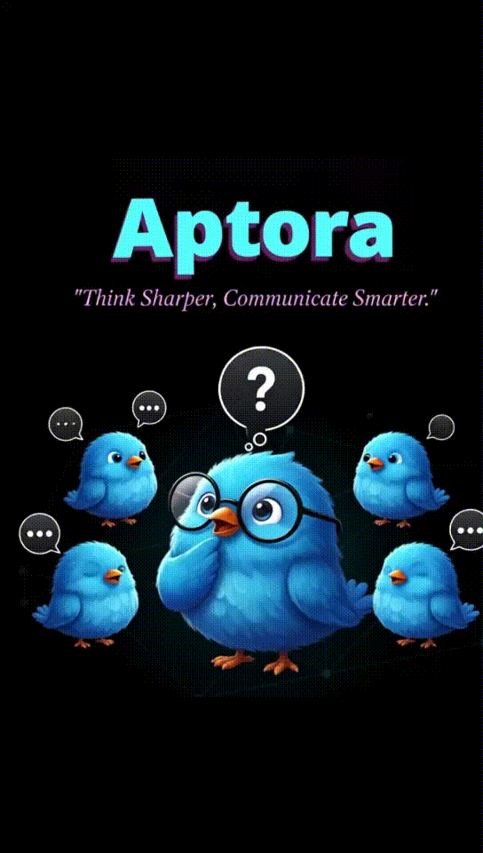
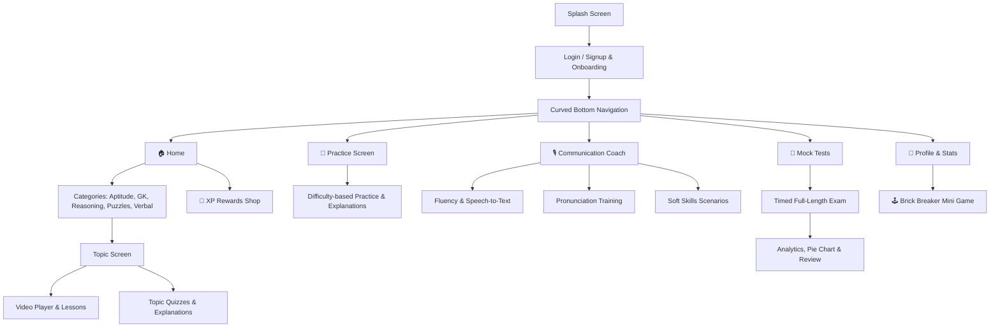

<div align="center">

# 🚀 Apttora

### *Master Aptitude, Refine Communication, and Ace Your Placement Journey*

[](https://flutter.dev/)
[](https://dart.dev/)
[](https://flutter.dev/)
[](LICENSE)

<br/>



</div>

---

## 📖 Table of Contents

- [Overview](#-overview)
- [✨ Key Features](#-key-features)
  - [1. Quantitative Aptitude & Reasoning](#1-quantitative-aptitude--reasoning)
  - [2. Interactive Video Learning](#2-interactive-video-learning)
  - [3. Apttora Speak — Communication & Speech Coach](#3-apttora-speak--communication--speech-coach)
  - [4. Timed Mock Tests & Deep Analytics](#4-timed-mock-tests--deep-analytics)
  - [5. Gamification, XP & Rewards Shop](#5-gamification-xp--rewards-shop)
  - [6. Break Time — Brick Breaker Mini Game](#6-break-time--brick-breaker-mini-game)
- [📱 App Architecture & Screens](#-app-architecture--screens)
- [🛠️ Tech Stack & Libraries](#️-tech-stack--libraries)
- [🚀 Getting Started](#-getting-started)
  - [Prerequisites](#prerequisites)
  - [Installation](#installation)
  - [Running the App](#running-the-app)
- [🔐 Permissions & Hardware Features](#-permissions--hardware-features)
- [📂 Project Directory Structure](#-project-directory-structure)
- [🤝 Contributing](#-contributing)
- [📄 License](#-license)
- [👤 Author & Acknowledgments](#-author--acknowledgments)

---

## 🌟 Overview

**Apttora** is a comprehensive, gamified mobile learning platform built with **Flutter**. Designed specifically for students and competitive job seekers preparing for campus recruitment, technical interviews, and government examinations, Apttora bridges the gap between **technical/quantitative problem solving** and **verbal/communication soft skills**.

With integrated video tutorials, adaptive practice questions, real-time speech-to-text pronunciation analysis, full-scale timed mock tests, and gamified XP rewards, Apttora turns placement preparation into an engaging daily habit.

---

## ✨ Key Features

### 1. Quantitative Aptitude & Reasoning
- **Multiple Core Domains**: Quantitative Aptitude, Logical Reasoning, General Knowledge (GK), Brain Puzzles, and Verbal Ability.
- **Tiered Difficulty**: Questions structured across **Easy**, **Medium**, and **Hard** levels to facilitate gradual learning.
- **Detailed Step-by-Step Explanations**: Instant solution walkthroughs for every single problem to reinforce concepts.

### 2. Interactive Video Learning
- **Topic-Focused Video Lectures**: High-quality video tutorials embedded natively using `youtube_player_flutter` and `video_player`.
- **Integrated Topic Quizzes**: Instant quiz evaluations immediately following each lecture to assess retention.

### 3. Apttora Speak — Communication & Speech Coach
- **Fluency Practice**: Speak freely on situational prompts while real-time **Speech-to-Text** analyzes pacing, pauses, and speech flow.
- **Pronunciation Training**: Listen to target speech, record your voice, and receive feedback to polish diction and clarity.
- **Soft Skills & Situational Scenarios**: Real-world workplace and interview communication challenges.
- **Streak & Badge System**: Daily practice streak tracker with unlockable milestones (e.g., 7-Day Speaking Streak).

### 4. Timed Mock Tests & Deep Analytics
- **Full-Length Mock Exams**: Realistic test conditions with countdown timers and dynamic question navigation.
- **Visual Performance Analytics**: Interactive **Pie Charts** displaying accuracy breakdown (Correct, Incorrect, Unattempted) and scoring percentiles.

### 5. Gamification, XP & Rewards Shop
- **Earn XP Points**: Gain XP for completing questions, video lectures, practice exercises, and mock exams.
- **In-App Shop**: Redeem earned XP for custom profile themes, badges, and avatars.
- **Profile Statistics**: Track historical performance, completed topics, and daily consistency.

### 6. Break Time — Brick Breaker Mini Game
- Need a mental refresh after intensive problem solving? Enjoy an arcade-style **Brick Breaker** mini game directly inside the app with smooth physics and paddle controls.

---

## 📱 App Architecture & Screens



---

## 🛠️ Tech Stack & Libraries

| Category | Technologies / Packages |
| :--- | :--- |
| **Framework** | [Flutter 3.x](https://flutter.dev/) (Dart SDK ^3.9.2) |
| **State Management** | [`provider`](https://pub.dev/packages/provider) |
| **UI & Styling** | Material 3, Custom Glassmorphism, [`curved_navigation_bar`](https://pub.dev/packages/curved_navigation_bar), [`google_fonts`](https://pub.dev/packages/google_fonts), [`lottie`](https://pub.dev/packages/lottie) |
| **Media & Audio** | [`speech_to_text`](https://pub.dev/packages/speech_to_text), [`audioplayers`](https://pub.dev/packages/audioplayers), [`record`](https://pub.dev/packages/record) |
| **Video Playback** | [`youtube_player_flutter`](https://pub.dev/packages/youtube_player_flutter), [`chewie`](https://pub.dev/packages/chewie), [`video_player`](https://pub.dev/packages/video_player) |
| **Data & Charts** | [`pie_chart`](https://pub.dev/packages/pie_chart), [`shared_preferences`](https://pub.dev/packages/shared_preferences), [`intl`](https://pub.dev/packages/intl) |
| **Device & Hardware** | [`image_picker`](https://pub.dev/packages/image_picker), [`permission_handler`](https://pub.dev/packages/permission_handler), [`path_provider`](https://pub.dev/packages/path_provider) |

---

## 🚀 Getting Started

### Prerequisites

Ensure you have the following installed on your machine:
- [Flutter SDK](https://docs.flutter.dev/get-started/install) (version 3.22.0 or higher recommended)
- [Dart SDK](https://dart.dev/get-dart)
- [Android Studio](https://developer.android.com/studio) or [VS Code](https://code.visualstudio.com/) with Flutter/Dart extensions
- An Android device/emulator, iOS simulator, or Chrome for Web testing

### Installation

1. **Clone the repository**:
   ```bash
   git clone https://github.com/23mh1a05g0/Apttora.git
   cd Apttora
   ```

2. **Install Flutter dependencies**:
   ```bash
   flutter pub get
   ```

3. **Verify Flutter setup**:
   ```bash
   flutter doctor
   ```

### Running the App

To run the application in debug mode on your connected device:

```bash
flutter run
```

To run on a specific target:
```bash
# For Android
flutter run -d android

# For Web
flutter run -d chrome

# For Windows Desktop
flutter run -d windows
```

### Building for Release

```bash
# Android APK
flutter build apk --release

# Android App Bundle (Play Store)
flutter build appbundle --release

# Web
flutter build web --release
```

---

## 🔐 Permissions & Hardware Features

Apttora utilizes device hardware features for its interactive communication module:
- **Microphone (`RECORD_AUDIO`)**: For Speech-to-Text and voice recording exercises.
- **Speech Recognition (`android.permission.RECORD_AUDIO`)**: For live fluency evaluation.
- **Camera & Photo Library**: Optional for setting custom user profile avatars.

These permissions are handled safely at runtime using [`permission_handler`](https://pub.dev/packages/permission_handler).

---

## 📂 Project Directory Structure

```plaintext
apttora/
├── assets/                       # Images, animated GIFs, and app icons
│   ├── appicon.png
│   ├── bg (1).png
│   └── ss.gif
├── lib/
│   ├── data/
│   │   └── question_data.dart    # Structured question bank & category data
│   ├── models/
│   │   ├── question_model.dart   # Question & Option data models
│   │   └── user_model.dart       # User profile & progress models
│   ├── pages/
│   │   ├── book_animation_screen.dart # Interactive animated onboarding
│   │   ├── bottomnavbar.dart     # Curved animated bottom navigation bar
│   │   ├── login_page.dart       # User authentication screen
│   │   ├── signup_page.dart      # Registration screen
│   │   └── splashscreen.dart     # Application splash screen
│   ├── screens/
│   │   ├── communication/        # Fluency, pronunciation & soft skills
│   │   ├── homescreen/           # Topic catalog, video lessons, quizzes, shop
│   │   ├── practicescreen/       # Category-wise practice test modules
│   │   └── profilescreen/        # User profile, statistics & brick breaker game
│   ├── mock_tests_screen.dart    # Mock test selection & timer configuration
│   ├── mocktests.dart            # Mock test execution & question navigation
│   ├── result_screen.dart        # Result summary & interactive chart analytics
│   └── main.dart                 # Application entry point
├── pubspec.yaml                  # Dependencies and assets configuration
└── README.md                     # Project documentation
```

---

## 🤝 Contributing

Contributions make the open-source community an inspiring place to learn, inspire, and create. Any contributions you make are **greatly appreciated**.

1. Fork the Project
2. Create your Feature Branch (`git checkout -b feature/AmazingFeature`)
3. Commit your Changes (`git commit -m "Add some AmazingFeature"`)
4. Push to the Branch (`git push origin feature/AmazingFeature`)
5. Open a Pull Request

---

## 📄 License

This project is licensed under the MIT License — see the [LICENSE](LICENSE) file for details.

---

## 👤 Author & Acknowledgments

- **Repository**: [23mh1a05g0 / Apttora](https://github.com/23mh1a05g0/Apttora)
- Developed with ❤️ for students, aspiring engineers, and placement candidates.
